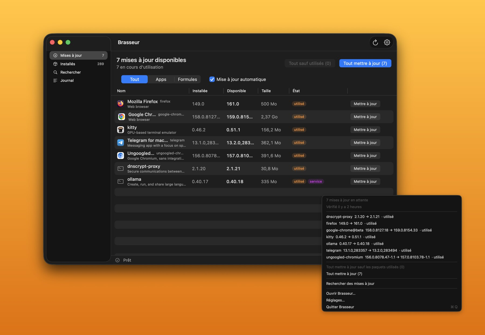
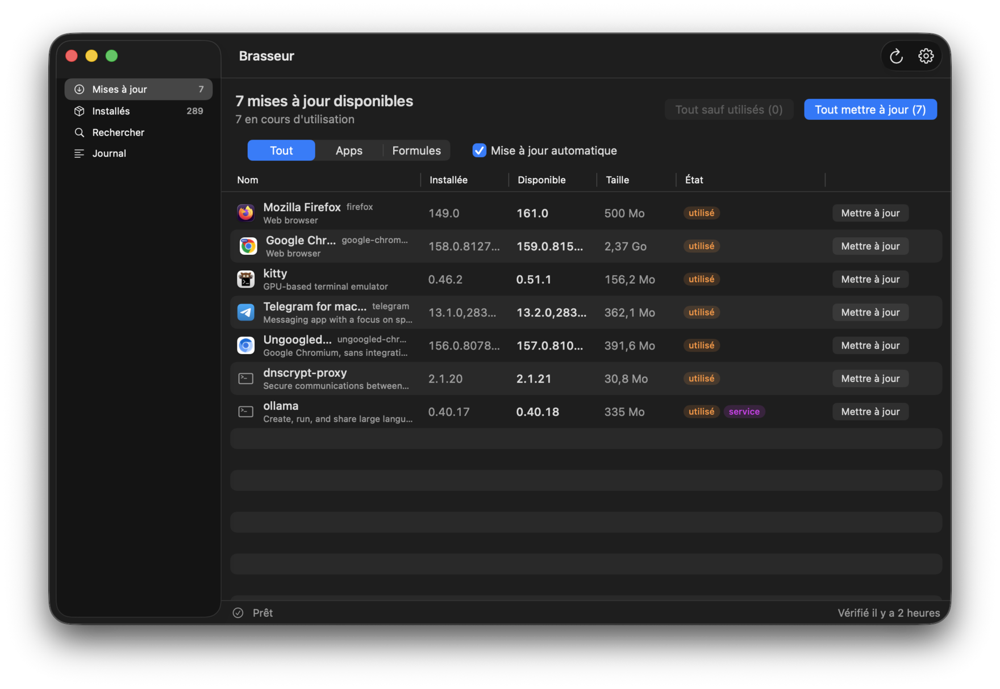
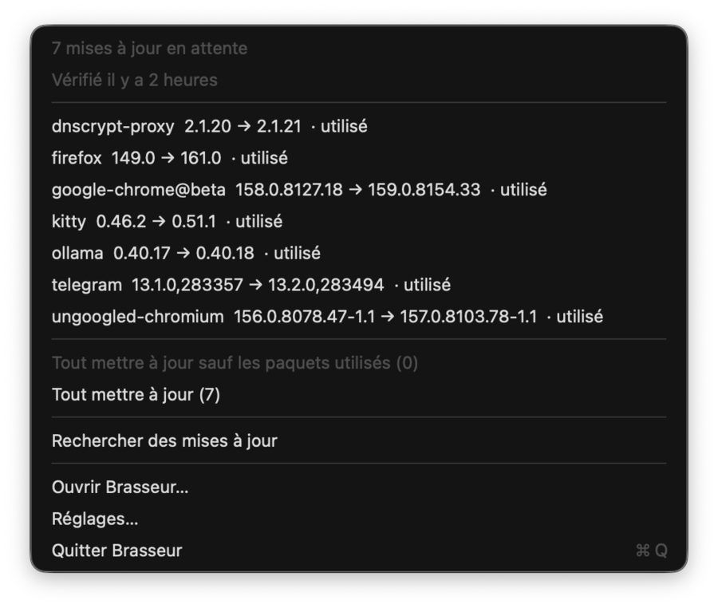
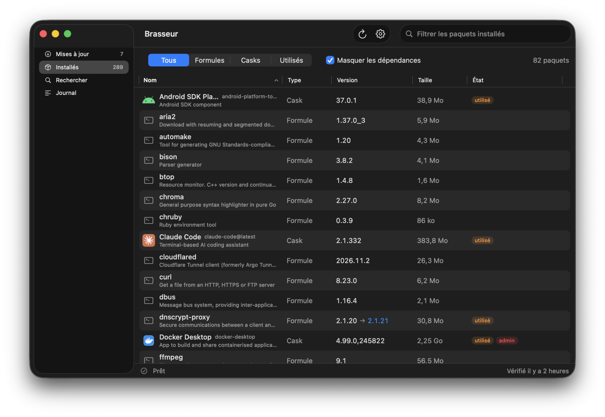
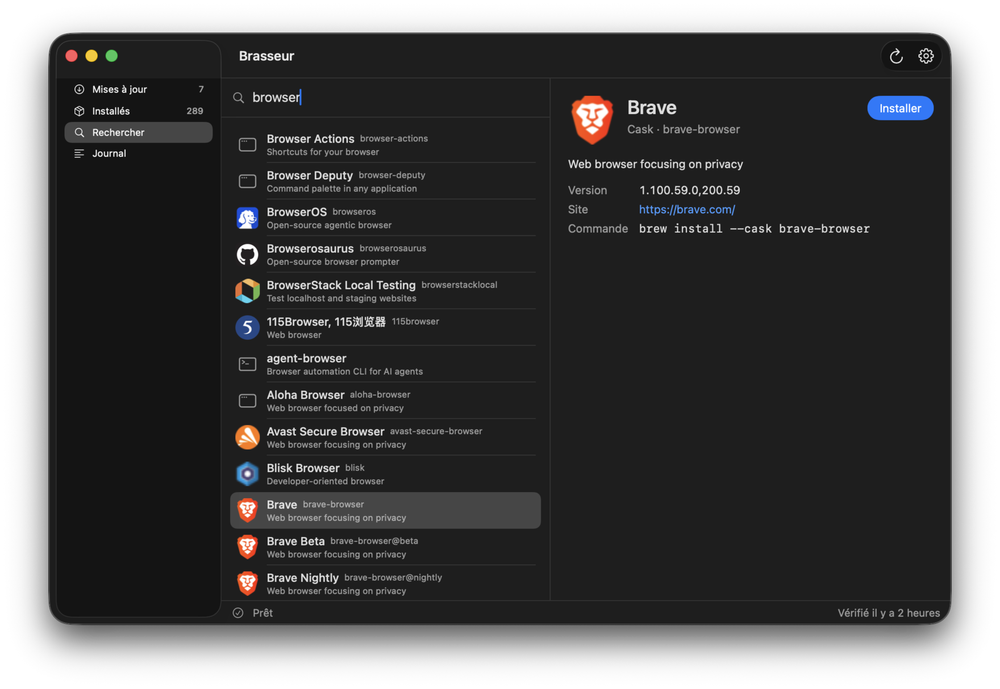
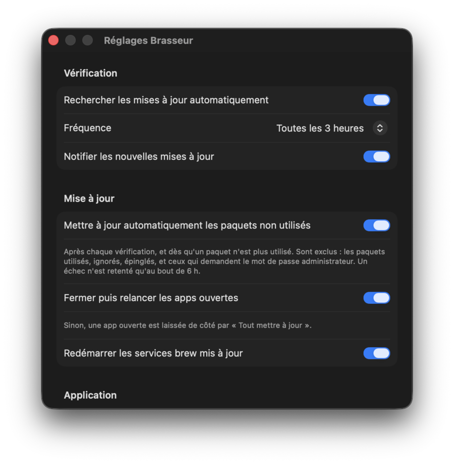

<p align="center">
  
</p>

<h1 align="center">Brasseur</h1>

<p align="center">
  <strong>Homebrew sans le terminal</strong><br>
  Une app macOS qui vit dans la barre des menus et garde vos paquets brew à jour.
</p>

<p align="center">
  <a href="https://github.com/dorianbayart/brasseur/releases/latest"></a>
  
  
  <a href="LICENSE"></a>
</p>

<p align="center">
  
</p>

## Pourquoi Brasseur

Avec Homebrew, chaque mise à jour se fait à la main, dans le terminal. Il faut savoir
que `brew update` ne met rien à jour, que les apps se mettent à jour avec `--cask`, et
que certaines n'apparaissent qu'avec `--greedy`. Après la mise à jour d'un service, il
faut encore le redémarrer avec `brew services restart` : une commande de plus à
connaître et à taper. Et il faut penser à faire tout ça régulièrement. Résultat : on
oublie, et les paquets prennent du retard.

Avec Brasseur, on lance l'app et c'est tout. Elle vérifie les nouvelles versions,
installe les mises à jour toute seule, en fond, et fait le ménage de temps en temps.
Rien à taper, rien à retenir.

Elle fait aussi attention à ce qui tourne sur le Mac :

- une app ouverte est fermée proprement, mise à jour, puis relancée ;
- un programme en cours d'utilisation n'est pas mis à jour sous vos pieds ;
- un service brew mis à jour est redémarré.

## Mises à jour



Les apps d'abord, puis les formules, puis les dépendances. On met à jour un paquet, la
sélection, tout, ou **tout sauf les paquets utilisés**. Chaque paquet porte des
pastilles qui disent son état : `utilisé`, `service`, `admin`, `épinglé`, `ignoré`,
`obsolète`…

Un paquet est « utilisé » si l'un de ses exécutables tourne (chemin réel sous
`Cellar/`, `Caskroom/` ou dans son `.app`) ou si son service brew est démarré.

## Dans la barre des menus



L'icône affiche le nombre de mises à jour en attente.

- **Un clic** ouvre le menu : la liste des mises à jour, « Tout mettre à jour »,
  « Rechercher des mises à jour », les réglages.
- **Un double-clic** ouvre la fenêtre.

En option : badge sur l'icône du Dock et notification quand de nouvelles versions
sortent.

Fermer la fenêtre ne quitte pas l'app : Brasseur reste dans la barre des menus.

<br clear="right">

## Paquets installés



Tous les paquets avec leur version et leur taille, filtrables par type (formules,
casks) ou par état (utilisés). Les dépendances sont masquées par défaut. Une fiche
détaillée s'ouvre en sélectionnant un paquet ; on peut le désinstaller (avec `--zap` en
option pour les casks).

## Rechercher et installer



Recherche par nom et par description, triée par pertinence puis par ordre alphabétique.
La fiche donne la version, le site, les dépendances et les avertissements. Si un paquet
est déprécié ou désactivé dans Homebrew, elle explique pourquoi et par quoi le
remplacer. Installation en un clic.

## Réglages



- **Vérification automatique** : `brew update` à intervalle réglable. Elle est mise en
  pause hors ligne, relancée au retour du réseau et après une mise en veille, puis
  retentée 15 min après un échec.
- **Mise à jour automatique** : ce qui n'est pas utilisé, ignoré, épinglé ni protégé
  par le mot de passe administrateur se met à jour seul.
- **Apps ouvertes** : les fermer puis les relancer, ou les laisser de côté.
- **Services** : redémarrer ceux qui ont été mis à jour.
- **Application** : icône dans le Dock, ouverture de la fenêtre et lancement à
  l'ouverture de session.

<br clear="right">

## Et aussi

- **Mot de passe administrateur** : les apps qui en ont besoin (installées par `.pkg`)
  ne sont jamais mises à jour automatiquement. Le mot de passe est demandé au moment du
  clic, puis oublié à la fin de l'opération.
- **Ignorer un paquet** (clic droit) : il est exclu des mises à jour groupées.
- **Entretien** : `brew cleanup` tous les 7 jours, en tâche de fond. Le menu Brew donne
  aussi le nettoyage, `brew autoremove` et le diagnostic `brew doctor`.
- **Journal** : la sortie de chaque commande brew, en direct. En cas d'échec, un
  bandeau mène au journal.
- **Une opération à la fois** : tout ce qui modifie brew passe par une file, dans
  l'ordre. « Arrêter » (⌘.) interrompt l'opération en cours et vide la file.
- **Langue** : français ou anglais, selon la langue du système.

### Léger en tâche de fond

- Les commandes lancées en fond tournent en priorité basse (`taskpolicy`), et brew ne
  télécharge qu'un fichier à la fois.
- Si l'image disque d'une app est occupée pendant sa mise à jour, Brasseur réessaie une
  fois 20 s plus tard.
- Un partage réseau qui ne répond plus bloque les recherches Spotlight, et donc brew.
  Après 10 s, Brasseur arrête la recherche bloquée et indique les partages en cause.

## Installer

Il faut macOS 15 ou plus, sur un Mac Apple silicon, et [Homebrew](https://brew.sh).

1. Télécharger `Brasseur-<version>.zip` depuis les
   [Releases](https://github.com/dorianbayart/brasseur/releases/latest).
2. Le décompresser et placer `Brasseur.app` dans `~/Applications` ou `/Applications`.

L'app n'est pas signée par un compte développeur Apple : au premier lancement, macOS la
bloque. Pour l'autoriser, ouvrir Réglages Système › Confidentialité et sécurité ›
« Ouvrir quand même », ou retirer la quarantaine :

```sh
xattr -dr com.apple.quarantine ~/Applications/Brasseur.app
```

## Construire

Seuls les Command Line Tools sont nécessaires (pas Xcode). Il faut macOS 15 ou plus.

```sh
./scripts/build.sh           # construit build/Brasseur.app
./scripts/build.sh install   # copie dans ~/Applications et relance
```

Diagnostic sans interface : `~/Applications/Brasseur.app/Contents/MacOS/Brasseur --selftest`.

## Publier une version

Pousser un tag `v*` : la CI GitHub construit l'app et publie une release avec le zip.

```sh
git tag v1.0.1 && git push origin v1.0.1
```

La CI ne garde que les 3 dernières releases (les tags restent). Elle ne conserve aucun
artefact ni cache GitHub Actions, pour ne pas remplir le quota de stockage. Lancée à la
main (onglet Actions), elle vérifie seulement que l'app se construit.

## Licence

Copyright © 2026 Dorian Bayart.

Brasseur est un logiciel libre, publié sous la licence
[GNU Affero General Public License v3.0](LICENSE) (AGPL-3.0).

Vous pouvez l'utiliser, l'étudier, le modifier et le redistribuer. En échange, toute
version modifiée que vous distribuez, ou que vous faites utiliser à d'autres à travers
un réseau, doit être publiée sous la même licence, avec son code source complet.
Personne ne peut donc reprendre Brasseur dans un produit fermé.

Brasseur n'est pas lié au projet Homebrew.
